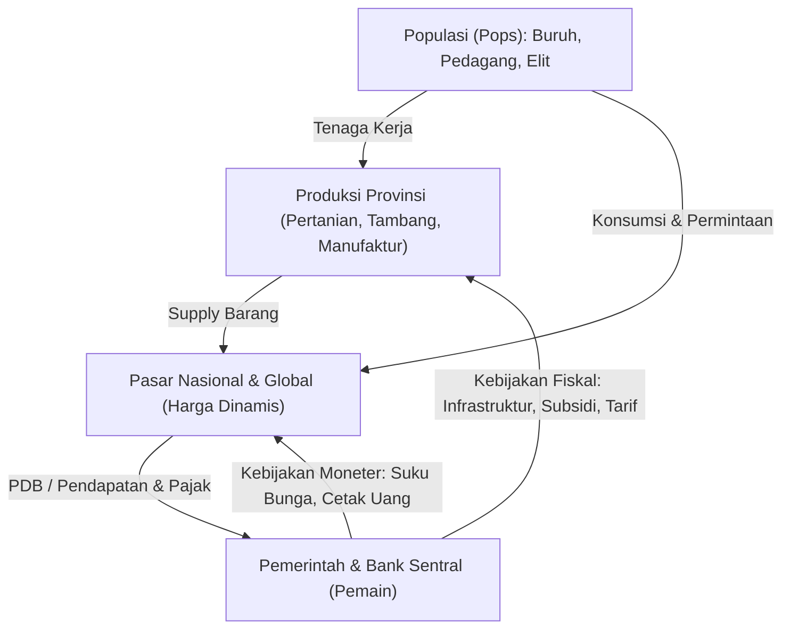

# Rancangan End-to-End: "Pax Economica" (Grand Strategy Macroeconomics di Godot 4)

Dokumen ini adalah cetak biru (*blueprint*) lengkap dari **Asset Pipeline** hingga **Rumus & Logika Kode (GDScript)** untuk membangun game simulasi makroekonomi berbasis peta (*map-painter / grand strategy* ala *Victoria 3* + *Civilization*) menggunakan **Godot Engine 4.x**.

---

## 1. Core Loop & Konsep Permainan ("Melatih Analisa Makroekonomi")

Agar game ini benar-benar melatih insting makroekonomi (bukan sekadar kumpul *gold* lalu beli pasukan), **uang di dalam game ini tidak muncul dari udara**, melainkan berputar di dalam sistem (*Closed/Semi-Closed Monetary Loop*) dan memiliki dampak nyata terhadap harga barang serta stabilitas peradaban.

### Cara Pemain Bermain (Analytical Gameplay Loop):
1. **Observe (Baca Indikator):** Pemain melihat peta mode ekonomi (misal: Provinsi A mengalami inflasi pangan tinggi, pengangguran naik di Provinsi B, neraca dagang defisit terhadap Kekaisaran tetangga).
2. **Hypothesize (Analisa Penyebab):** *"Harga gandum naik karena populasi tumbuh cepat tapi infrastruktur irigasi dan jalur logistik dari provinsi agraris macet (*supply shock*)."*
3. **Intervene (Ambil Kebijakan):**
   - **Fiskal:** Bangun pelabuhan/jalan di provinsi agraris, turunkan tarif impor pangan sementara, atau beri subsidi pupuk.
   - **Moneter:** Naikkan suku bunga acuan jika inflasi bersifat agregat (*demand-pull*), atau devaluasi mata uang untuk mendorong ekspor manufaktur.
4. **Evaluate (Lihat Dampak):** Amati grafik CPI (Inflasi), GDP Growth, Kurva Imbal Hasil (*Bond Yield*), dan kepuasan masyarakat (*Standard of Living*) beberapa *tick* kemudian.

---

## 2. Kebutuhan Asset & Pipeline

Sistem visual menggunakan gaya **"Living Parchment / War Room Table Map"**:
1. **`provinces_id.png` (Hidden Texture):** Gambar bitmap tanpa *anti-aliasing* di mana setiap provinsi memiliki 1 warna RGB unik.
2. **`heightmap.png` & `terrain_texture.png`:** Tekstur visual untuk daratan, pegunungan, sungai, dan laut.
3. **`map_modes_lut.png` (1D Gradient Textures):** Tekstur gradasi warna untuk mewarnai provinsi secara dinamis via Shader berdasarkan data (*GDP per Capita*, *Inflation Heat*, *Standard of Living*, *Trade Balance*).
4. **UI & Data Visualization:** *9-Patch Texture* (`NinePatchRect`), ikon SVG komoditas & indikator makro, serta komponen grafik *time-series* berbasis `_draw()`.

---

## 3. Logika & Rumus Tiap Fitur (End-to-End Implementation)

### Fitur 1: Sistem Peta Interaktif (Shader & Color-ID Picking)
- Saat game dimuat, `MapPicker.gd` membaca `provinces_id.png` ke dalam memori (`Image` di Godot).
- Klik koordinat `(x, y)` di peta membaca warna piksel `image.get_pixel(x, y)` -> mencocokkan `color_to_province_id` -> membuka panel provinsi tersebut.
- Pewarnaan *Map Mode* menggunakan `ImageTexture` 1D (`256x1` atau `4096x1`) yang di-lookup secara instan oleh `map_political.gdshader`.

### Fitur 2: Produksi, Pasar Dinamis, dan Harga
1. **Fungsi Produksi (Cobb-Douglas yang Disederhanakan):**
   $$Y_i = A \cdot K^\alpha \cdot L^{1-\alpha} \cdot I_{eff}$$
2. **Pembentukan Harga Pasar (*Market Clearing Price*):**
   $$P_i(t) = P_{base, i} \cdot \left( 1 + k \cdot \frac{D_i - S_i}{\max(S_i, D_i, 1)} \right) \cdot M_{mult}$$

### Fitur 3: Perhitungan GDP & Inflasi (CPI)
1. **Nominal GDP (*Expenditure Approach*):**
   $$GDP_{nominal} = C + I + G + (X - M)$$
2. **Real GDP (Harga Tahun Dasar $P_{base}$):**
   $$GDP_{real} = \sum_{i} Q_{produced, i} \cdot P_{base, i}$$
3. **Indeks Harga Konsumen (CPI) & Laju Inflasi ($\pi$):**
   $$CPI(t) = \sum_{i} w_i \cdot \frac{P_i(t)}{P_{base, i}} \times 100$$
   $$\pi = \frac{CPI(t) - CPI(t - 12)}{CPI(t - 12)} \times 100\%$$

### Fitur 4: Bank Sentral & Kebijakan Moneter
- **Suku Bunga Acuan ($r$):** Mempengaruhi tingkat tabungan rumah tangga, konsumsi ($C$), investasi swasta ($I$), *velocity of money* ($V$), dan bunga obligasi pemerintah baru.
- **Cetak Uang / *Quantitative Easing* ($\Delta M$):** Menambah jumlah uang beredar ($M$) yang meningkatkan faktor pengali moneter $M_{mult}$ sesuai rasio $\frac{M \cdot V}{Y_{real}}$.

### Fitur 5: Kebijakan Fiskal, Obligasi Negara (*Bonds*), dan Krisis Utang
$$Y_{bond} = r + \max\left(0, \left(\frac{\text{Total Debt}}{GDP_{nominal}} - 0.60\right) \times 0.15\right) + \text{Default Risk Premium}$$

### Fitur 6: Perdagangan Internasional & Nilai Tukar (*FX Rate*)
$$\Delta FX_{A/B} \propto (X_A - M_A) + \gamma (r_A - r_B) - (\pi_A - \pi_B)$$

